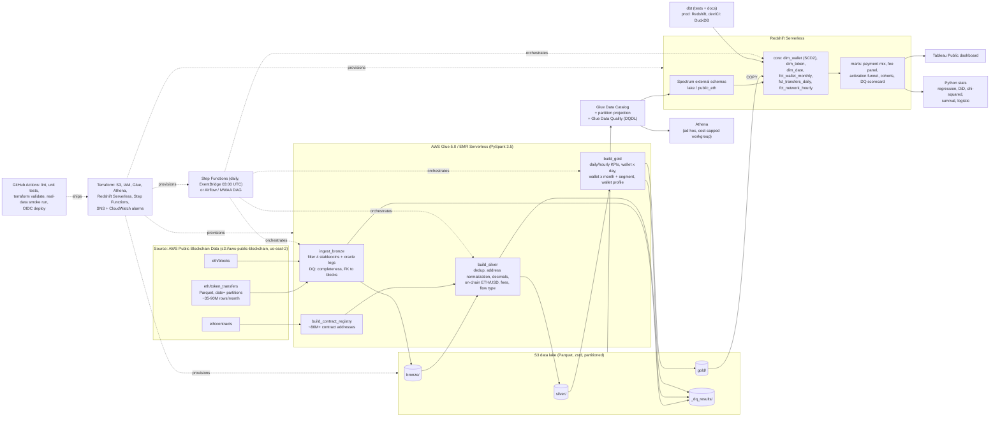

# Architecture

## Design decisions

| Decision | Why | Trade-off |
|---|---|---|
| Read the public bucket in place (s3a locally, s3 on Glue) instead of copying it | No 10+ TB copy. Column pruning and partition pruning mean a month costs ~4 GB of reads, not the full files. | Depends on the public dataset's schema staying stable; bronze DQ checks catch drift. |
| Bronze keeps raw padded addresses and raw integer amounts | Bronze must be replayable and auditable against the source. Normalization lives in silver, where it's unit-tested. | Bronze is slightly larger. |
| ETH/USD derived from Uniswap swaps, not an API | Fully reproducible from the same dataset, with no external dependency or licence. | Hourly median, ignores dust; validated by a plausibility DQ check. |
| Transfer-level detail stays in S3 (Spectrum); aggregates go to Redshift | ~300M rows for two years, billions for full history. Dashboards only need aggregates. Spectrum handles the occasional drill-down. | Drill-downs are slower and bill per TB scanned. The analyst Athena workgroup has a 200 GB per-query cap. |
| `DISTKEY(wallet)` on dim_wallet and the wallet facts | SCD2 as-of joins and cohort building are wallet-keyed, so they co-locate with no redistribution. | Whale wallets can skew slices; monitored with `svv_table_info.skew_rows`. |
| SCD2 on wallet segment (gaps-and-islands) | Segments change month to month. Reports must show the segment a wallet had *at the time*. | More rows than a Type 1 dimension. |
| Dynamic partition overwrite everywhere | Any day or month can be re-run idempotently, so backfills are safe. | One writer per table (Glue `max_concurrent_runs = 1`). |
| Contract flags via semi-join + broadcast | The registry has 78.6M addresses; a month touches a few million. Semi-joining once gives a small contract set that is broadcast to both sides of the transfer. | One extra pass over the month's distinct addresses. |
| Gold wallet tables built month by month | Each month's shuffle is about 1/24 of the window, so spill stays small and any month can be rebuilt alone. Monthly and lifetime tables then read the compact wallet x day table. | A loop of 24 small jobs instead of one big one. |
| dbt with DuckDB for dev/CI and Redshift for prod | Same SQL tested on every PR against real data, without a cluster. | Dialect differences handled with dbt cross-database macros. |

## Scale and cost (two-year window, measured locally)

Measured numbers are in `reports/pipeline_run.md` after a run. Rough AWS cost to run the full
two-year backfill once: Glue at 10 G.1X workers x ~2 h x $0.44/DPU-h ≈ $9. Athena exploration is
$5/TB scanned, and typical queries scan under 5 GB. Redshift Serverless at 8 RPU is $0.375/RPU-h,
billed only while queries run.
