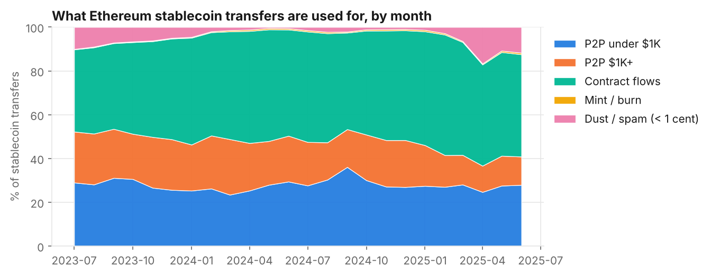

# Q1. How much stablecoin activity looks like payments?

Window: Jul 2023 to Jun 2025. 215,021,088 USDC, USDT, DAI and PYUSD transfers, $19.84 trillion moved.

## Mix over the full window
| flow_category | transfers | share_of_transfers | volume_usd | share_of_volume | avg_ticket_usd |
|---|---|---|---|---|---|
| p2p_small_ticket | 59,614,156 | 0.2772 | 13,790,316,935.9276 | 0.0007 | 231.3262 |
| p2p_large_ticket | 39,383,253 | 0.1832 | 5,888,078,550,376.3672 | 0.2968 | 149,507.1662 |
| contract_flow | 103,046,935 | 0.4792 | 10,112,062,545,682.4863 | 0.5097 | 98,130.6484 |
| mint_burn | 1,090,964 | 0.0051 | 3,825,193,576,424.6777 | 0.1928 | 3,506,250.9638 |
| dust_spam | 11,885,780 | 0.0553 | 6,777.4777 | 0.0000 | 0.0006 |

**Read:** person-to-person transfers under $1K are 27.7% of transfers but only
0.07% of value. Value is dominated by contract flows and large
wallet-to-wallet moves (exchanges, market makers, treasury). The share of small P2P transfers moved from
29.0% in Jul 2023 to 27.9% in Jun 2025.

## USDC vs USDT: who carries the payment-like traffic?
| token_symbol | p2p_small | total | p2p_small_share |
|---|---|---|---|
| USDT | 43,931,163 | 129,882,696 | 0.3382 |
| USDC | 14,502,178 | 78,532,542 | 0.1847 |
| DAI | 493,984 | 5,610,694 | 0.0880 |
| PYUSD | 686,831 | 995,156 | 0.6902 |

Small-ticket P2P share, USDT minus USDC: +15.36 pp (95% CI +15.35 to +15.37),
z = 2391.8. With hundreds of millions of rows almost any gap is "significant", so the effect size (Cohen's h =
0.353) is the number to judge.

## Wallet segments (wallet-months)
Each active wallet is re-scored every month by behaviour (rules in `docs/metric_definitions.md`).

| segment | wallet_months | share_wallet_months | volume_sent_usd | share_volume | usdc_primary_share |
|---|---|---|---|---|---|
| payment_like | 23,742,450 | 0.5601 | 64,218,289,193.6133 | 0.0087 | 0.2762 |
| receive_only | 8,660,545 | 0.2043 | 0.0000 | 0.0000 | 0.2872 |
| defi_contract_user | 7,112,886 | 0.1678 | 942,467,809,199.0363 | 0.1281 | 0.5038 |
| other | 2,318,483 | 0.0547 | 229,662,448,971.2627 | 0.0312 | 0.2781 |
| large_value_mover | 500,449 | 0.0118 | 2,147,568,229,550.6584 | 0.2918 | 0.3242 |
| high_throughput_service | 53,290 | 0.0013 | 3,975,462,297,595.4868 | 0.5402 | 0.2402 |

Segment mix differs by primary token: chi-squared = 1,381,471 (df 5), Cramer's V = 0.181.
