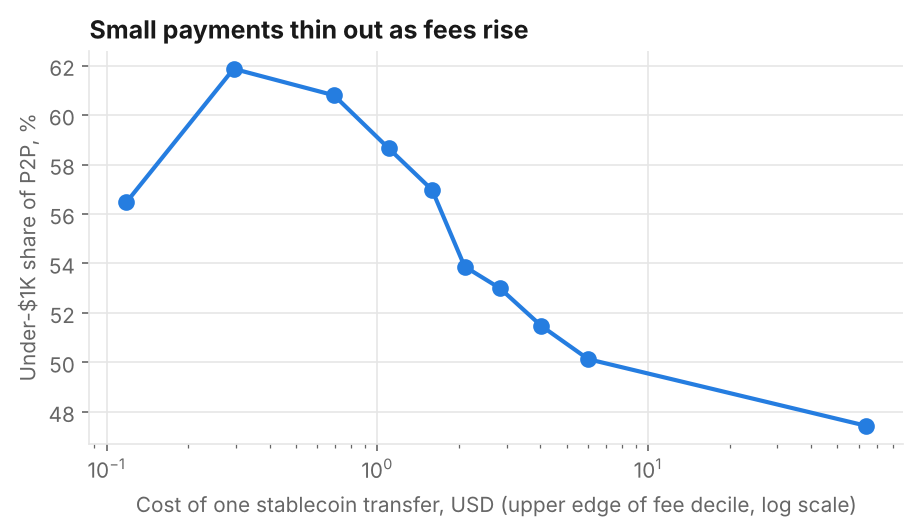

# Q2. Fee sensitivity of small payments

17,544 hours, 2023-07-01 to 2025-06-30. Median transfer cost $1.59
(p10 $0.12, p90 $6.01).

## Fee deciles (descriptive)
| fee_decile | fee_from | fee_to | hours | small_share | small_per_hour | large_per_hour |
|---|---|---|---|---|---|---|
| 1 | 0.0337 | 0.1185 | 1,755 | 0.5648 | 5,395.7293 | 770.5191 |
| 2 | 0.1185 | 0.2947 | 1,754 | 0.6187 | 5,245.9327 | 817.2737 |
| 3 | 0.2950 | 0.6916 | 1,754 | 0.6080 | 3,899.9458 | 767.2149 |
| 4 | 0.6917 | 1.1026 | 1,755 | 0.5865 | 3,022.1789 | 676.6040 |
| 5 | 1.1027 | 1.5926 | 1,754 | 0.5698 | 2,877.3803 | 697.7782 |
| 6 | 1.5928 | 2.1006 | 1,754 | 0.5388 | 2,674.8757 | 711.6881 |
| 7 | 2.1006 | 2.8367 | 1,755 | 0.5300 | 2,776.3481 | 790.7362 |
| 8 | 2.8367 | 4.0298 | 1,754 | 0.5148 | 2,769.5690 | 838.6100 |
| 9 | 4.0303 | 6.0080 | 1,754 | 0.5013 | 2,667.3808 | 885.4778 |
| 10 | 6.0086 | 63.8539 | 1,755 | 0.4743 | 2,650.3123 | 1,047.3852 |

## Elasticity of under-$1K P2P transfers with respect to fee (log-log, Newey-West SE)
| model | elasticity | ci_low | ci_high | p_value | r2 | n_hours |
|---|---|---|---|---|---|---|
| 1. Naive (no controls) | -0.1627 | -0.1726 | -0.1528 | 0.0000 | 0.3157 | 17,544 |
| 2. + hour, weekday, month fixed effects | -0.0860 | -0.1023 | -0.0697 | 0.0000 | 0.8282 | 17,544 |
| 3. + large-ticket and network demand controls | -0.1489 | -0.1630 | -0.1348 | 0.0000 | 0.8596 | 17,544 |

The naive model is contaminated by simultaneity (busy hours have both more transfers and higher fees).
Adding fixed effects and demand controls moves the estimate to **-0.149**: a 10% higher fee goes with
about 1.5% fewer small transfers in that hour, holding demand fixed.

## Relative elasticity (stacked small vs large model)
Small-ticket elasticity minus large-ticket elasticity: **-0.241** (95% CI -0.265 to -0.217),
p = 2.3e-84. Shocks that hit both groups cancel out here, so this is the most
credible number: small payments are clearly more fee-sensitive than large ones.

## Correlation (no controls)
* Pearson r(log fee, small-ticket share) = -0.408 (95% CI -0.420 to -0.395)
* Spearman rho(fee, small-ticket share) = -0.515 (95% CI -0.526 to -0.504)

Correlation is shown for context only. It mixes fee effects with time trends, which the regression controls for.
