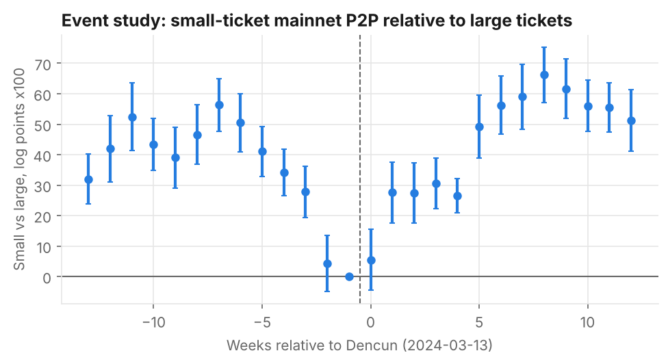

# Q3. Did Dencun pull small payments off Ethereum mainnet?

Window: 2023-12-13 to 2024-06-12 (13 weeks either side).

## Raw 2x2
| group | period | avg_daily_transfers | avg_fee_usd |
|---|---|---|---|
| large ($10K+) | post | 19,191.6703 | 3.7183 |
| large ($10K+) | pre | 18,607.5055 | 6.4056 |
| small (<$1K) | post | 64,194.6154 | 3.7183 |
| small (<$1K) | pre | 57,237.4505 | 6.4056 |

## Difference-in-differences
| Specification | Effect on small vs large (log points) | % effect | 95% CI (%) | p |
|---|---|---|---|---|
| Main: day fixed effects | +0.079 | +8.3% | -1.2% to +18.7% | 0.09 |
| + mainnet fee x group | -0.123 | -11.6% | -14.8% to -8.3% | 3.8e-11 |
| Placebo (fake date 2023-12-13) | -0.173 | -15.9% | -23.2% to -7.9% | 0.00019 |

**Parallel trends:** the largest pre-period weekly coefficient is 0.563 log points.
Pre-period coefficients are not flat, so read the estimate with caution: some of the gap may be a trend that started before Dencun.

**Placebo:** the fake date also shows an effect, which weakens the causal reading.

**Interpretation:** day fixed effects absorb everything that moved both groups (ETH price, market
volatility, holidays), so the main row is the change in small-ticket activity *relative to* large-ticket activity
after Dencun. **Verdict: no credible causal effect.** The main estimate is not significant (p = 0.09), the pre-period coefficients drift (max 0.56 log points), and the placebo date shows an effect of similar size (p = 0.00019). Small and large tickets were already on different paths around the turn of the year, so this design can't separate Dencun from that drift. The fee-elasticity estimate in Q2 is the more reliable evidence on fee sensitivity. Rejecting a tempting causal story is the right call here, and the memo says so.
