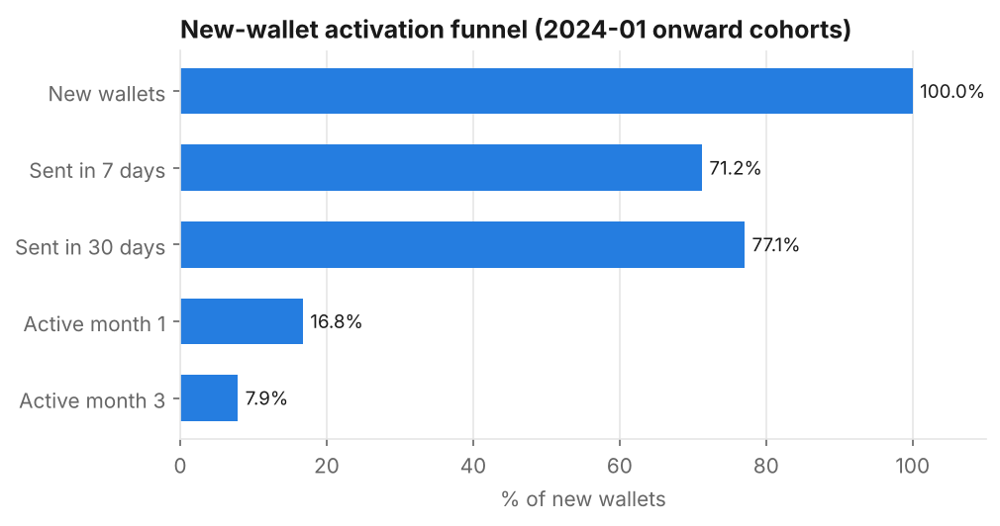
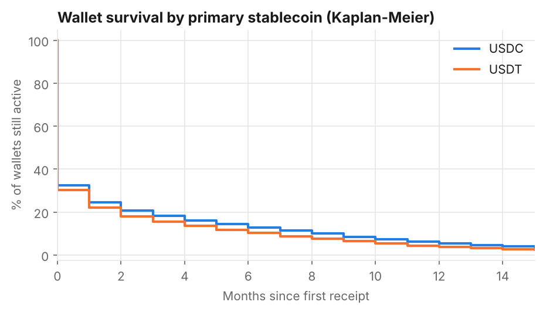

# Q4. New-wallet activation and retention

17,854,184 new wallets that entered by receiving a stablecoin, cohorts Jan 2024 to
Jun 2025.

| Step | Wallets | Rate |
|---|---|---|
| Received first stablecoin | 17,854,184 | 100% |
| Sent within 7 days (activation) | 12,719,771 | 71.2% |
| Sent within 30 days | 13,759,799 | 77.1% |
| Active in month 1 | 2,991,059 | 16.8% |
| Active in month 3 (cohorts with 3 months observed) | 1,093,507 | 7.9% |

## Activation by size of first receipt
| first_receive_band | new_wallets | sent_7d | activation_7d |
|---|---|---|---|
| $100-1K | 5,872,767 | 4,411,101 | 0.7511 |
| $10K+ | 929,218 | 829,942 | 0.8932 |
| $1K-10K | 2,846,618 | 2,513,069 | 0.8828 |
| under_$100 | 8,205,581 | 4,965,659 | 0.6052 |

Chi-squared test of independence: chi-squared = 1,055,358, df = 3, p < 0.001,
Cramer's V = 0.243.

# Q5. USDC vs USDT

| Metric | USDC | USDT | USDT - USDC | 95% CI | p |
|---|---|---|---|---|---|
| 7-day activation | 73.0% | 70.4% | -2.55 pp | -2.59 pp to -2.50 pp | < 0.001 |
| Month-3 retention | 8.2% | 7.8% | -0.41 pp | -0.44 pp to -0.38 pp | < 0.001 |

Log-rank test (survival curves equal?): chi-squared = 348.5, p = < 0.001
(on a random sample of 232,386 wallets).

## What predicts month-3 retention? (logistic regression, 232,386-wallet sample, cohort fixed effects)
| term | odds_ratio | ci_low | ci_high | p_value |
|---|---|---|---|---|
| C(primary_token, Treatment('USDT'))[T.USDC] | 1.0789 | 1.0425 | 1.1167 | 0.0000 |
| C(band, Treatment('under_100'))[T.100_1K] | 1.5397 | 1.4815 | 1.6002 | 0.0000 |
| C(band, Treatment('under_100'))[T.10K_plus] | 2.2930 | 2.1438 | 2.4525 | 0.0000 |
| C(band, Treatment('under_100'))[T.1K_10K] | 2.0532 | 1.9590 | 2.1520 | 0.0000 |
| sent_7d | 1.5075 | 1.4531 | 1.5640 | 0.0000 |
| pass_through | 0.0854 | 0.0820 | 0.0889 | 0.0000 |

AUC = 0.772.

## The activation metric is mostly pass-through traffic
The naive reading of the funnel is "71.2% of new wallets activate". But in a model
*without* the pass-through flag, a week-one send goes with an odds ratio of **0.55** for month-3 retention:
activation looks like it predicts churn. Add a flag for pass-through wallets (send at least 95% of what they received,
at most 3 active days) and the sign flips: activation's odds ratio becomes
**1.51**, and pass-through itself is
0.09. A classic confounder: the two kinds of wallet were
pooled in one metric. On the full population (cohorts Jan 2024 to Mar 2025):

| sent_within_7d | wallet_type | wallets | active_after_60d | share_of_new_wallets |
|---|---|---|---|---|
| yes | holds a balance | 1,954,790 | 0.6027 | 0.1409 |
| yes | pass-through | 7,747,290 | 0.0530 | 0.5585 |
| no | holds a balance | 2,841,778 | 0.2349 | 0.2049 |
| no | pass-through | 1,326,656 | 0.4533 | 0.0956 |

79.9% of "activated" wallets are pass-through, and only 5.3% of them are
still active 60+ days after their first receipt, against 60.3% for activated wallets that
keep a balance. These are typically exchange deposit addresses and one-shot forwarding wallets. **Recommendation:**
define activation as "sent within 7 days *and* kept a balance", and report pass-through wallets separately.
Otherwise the KPI rewards churn.
